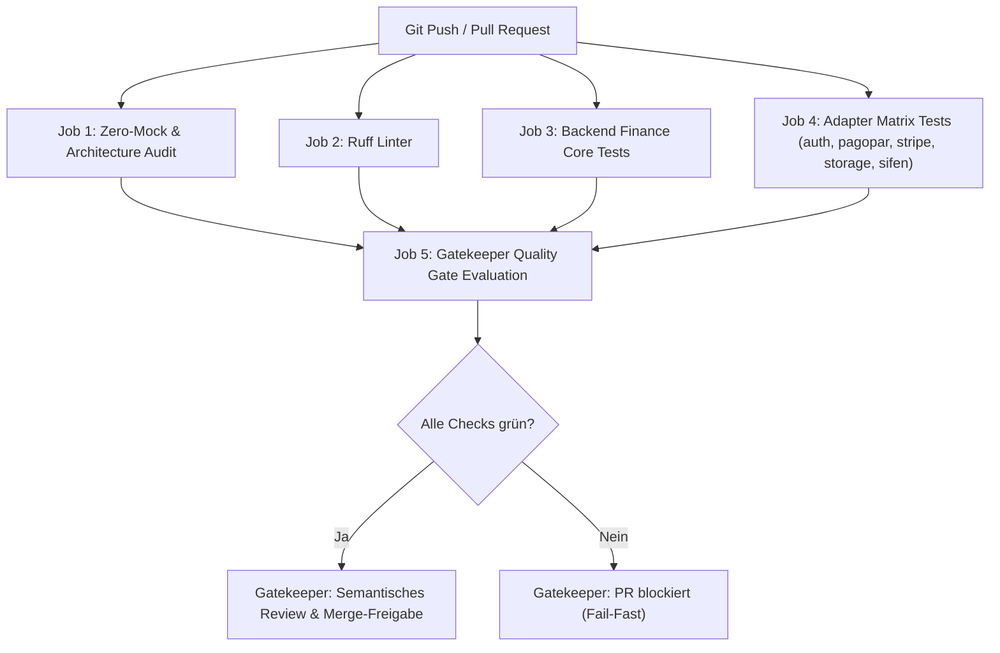

# Gatekeeper CI & Automatisierte Qualitätsprüfung

Dieses Dokument beschreibt die Architektur, Konfiguration und das Zusammenspiel zwischen den GitHub Actions CI-Workflows und dem Agenten **Gatekeeper**.

---

## 1. Kontext und Zielsetzung

Zur Einhaltung und Schonung des monatlichen Gemini Tokenlimits werden rechenintensive Tests, Linter-Prüfungen und Mock-Scans vollständig in GitHub Actions ausgelagert:
* **Rechenentlastung**: GitHub Actions führt 170+ automatisierte Tests, Linter-Prüfungen und AST-basierte Mock-Scans auf GitHub-Servern aus.
* **Token-Einsparung**: Gatekeeper muss keine riesigen Testausgaben oder Linter-Logs mehr parsen, sondern prüft primär das deterministische CI-Ergebnis und konzentriert seine Tokens auf die semantische Architektur- und Invarianzprüfung (Einsparung ca. 80-90%).
* **Kompromisslose Qualität**: Pull Requests werden automatisch blockiert, wenn Tests fehlschlagen oder gegen die Zero Mock Doktrin verstoßen wird.

---

## 2. Architektur des GitHub Actions Workflows

Der Workflow ist definiert in [`.github/workflows/gatekeeper_ci.yml`](../.github/workflows/gatekeeper_ci.yml).

### Auslöser (Triggers)
* `push` auf Hauptbranches (`main`, `master`)
* `pull_request` auf Hauptbranches (`main`, `master`)
* Manuelle Ausführung via `workflow_dispatch`

### Die 5 Prüfstufen (Jobs)



1. **`zero-mock-audit` (Zero Mock & Architecture Invariance)**:
   * Führt das Audit-Tool [`scripts/audit_zero_mock.py`](../scripts/audit_zero_mock.py) aus.
   * Prüft den gesamten Python-Produktivcode auf verbotene Mock-Bibliotheken (`unittest.mock`, `MagicMock`, `patch`).
   * Erkennt verbotene Dummy-Stubs (`pass`, `raise NotImplementedError`).
   * Erkennt Bypass-Flags (`MOCK_MODE = True`, `SKIP_AUTH = True`).
   * Validiert Test-Dateien gegen Scheintests (Tests ohne Assertions).
   * Verifiziert die **VibeCore Core-Invarianz** (Core darf keine externen Adapter importieren).
   * Verifiziert die **Adapter-Isolation** (Adapter dürfen nicht direkt auf PostgreSQL zugreifen).
   * Schreibt einen detaillierten Befundbericht in das `$GITHUB_STEP_SUMMARY`.

2. **`linter` (Ruff Code-Qualität)**:
   * Führt `ruff check .` über das gesamte Repository aus.
   * Überwacht Syntax, ungenutzte Imports (`F401`), Importsortierung (`I001`) und Python 3.12+ Standards (`UP`).

3. **`test-backend` (Finance Core)**:
   * Installiert `sdk` und `backend[dev]`.
   * Führt alle Unittests der doppelten Buchführung, Ley 6380/19 IVA-Klassifizierung und Transaktions-Outbox aus (`cd backend && pytest -v tests`).

4. **`test-adapters` (Microservice Adapter Matrix)**:
   * Parallelisierte Matrix über alle Adapter: `auth`, `pagopar`, `stripe`, `storage`, `sifen`.
   * Führt modulspezifische Test-Suiten mit isolierten Abhängigkeiten aus.

5. **`gatekeeper-gate` (Quality Gate Evaluation)**:
   * Aggregiert alle Ergebnisse und erzeugt eine tabellarische Zusammenfassung im GitHub Step Summary.
   * Verweigert den Durchlauf mit Exit-Code 1, falls ein einziger Upstream-Check fehlschlägt.

---

## 3. Zusammenspiel mit dem Agenten Gatekeeper

Gatekeeper agiert als autorisierte Prüfinstanz vor dem Merge nach `main`. Das Zusammenspiel erfolgt in einem 2-Stufen-Modell:

### Stufe 1: Deterministische CI-Prüfung (Fail-Fast)
1. Gatekeeper prüft bei Vorlage eines PRs zuerst das Ergebnis des GitHub Actions Workflows (`gatekeeper_ci.yml`).
2. **Wenn CI rot ist (`failure`)**:
   * Gatekeeper lehnt den PR sofort ab.
   * Der Entwickler-Agent erhält die exakte Fehlermeldung aus dem GitHub Step Summary als Blocker.
   * Es werden **keine** Token für aufwendige manuelle Testläufe oder Code-Analysen verschwendet.

### Stufe 2: Semantisches Review (High-Level Gate)
1. **Wenn CI grün ist (`success`)**:
   * Gatekeeper weiß sicher, dass alle 170+ Unittests grün sind, der Linter sauber ist und die Zero Mock Doktrin syntaktisch eingehalten wurde.
   * Gatekeeper konzentriert sich nun ausschließlich auf:
     - **Architektur & Fachlichkeit**: Wurde die Fachlichkeit (z.B. Ley 6380/19, Buchhaltungsinvarianz) semantisch korrekt implementiert?
     - **Die 4 Säulen**: Resilienz (Timeouts/Idempotenz), Datenintegrität (ACID), Sicherheit (Auth/RBAC) und Observability (Logging/Healthchecks).
     - **Release Gate**: Einhaltung von Semantic Versioning (keine eigenmächtigen v1-Tags vor Pascal-Freigabe).
   * Gatekeeper erteilt die formale Freigabe für den Merge.

---

## 4. Lokale Nutzung für Entwickler

Vor dem Push oder PR können Entwickler alle Gatekeeper-Checks lokal ausführen:

```bash
# 1. Zero-Mock & Architecture Audit
python scripts/audit_zero_mock.py

# 2. Linter ausführen
ruff check .

# 3. Backend Tests
cd backend && pytest tests

# 4. Adapter Tests (Beispiel Pagopar)
cd adapters/pagopar && PYTHONPATH=. pytest tests
```
